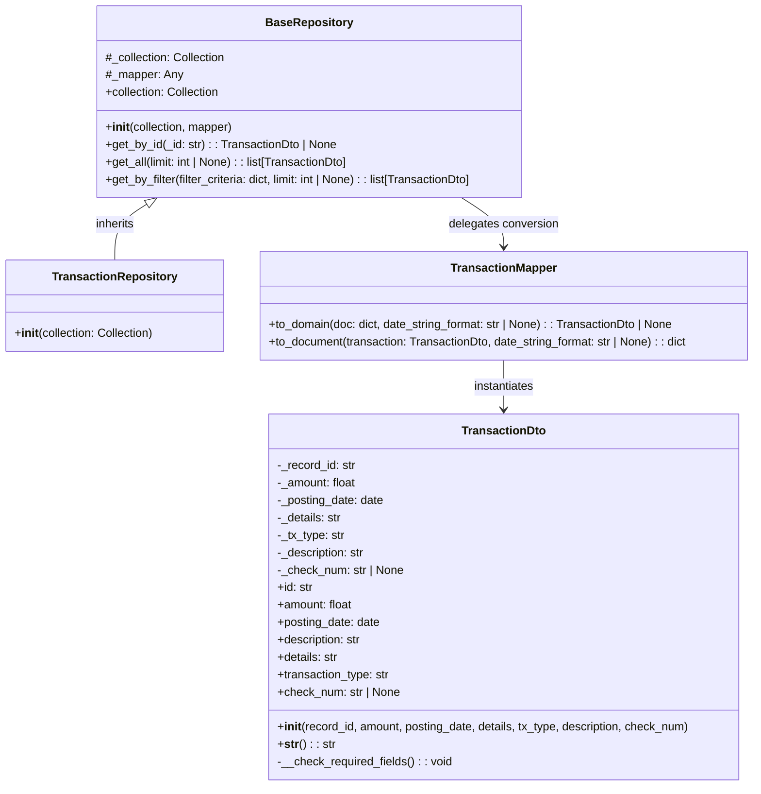

# Datalake Storage, Domain Contracts & Query Limit Specification

**Target Packages**: `features/datalake/`  
**Architectural Role**: Persistence Domain Contracts & Datalake Repository Adapter Layer  
**Document Status**: Canonical / Active Specification (Phase 1B)  
**Primary Classes**: [`TransactionDto`](../../features/datalake/repository.py), [`BaseRepository`](../../features/datalake/repository.py), [`TransactionRepository`](../../features/datalake/repository.py), [`TransactionMapper`](../../features/datalake/repository.py)  
**Parent Document**: [`docs/specs/README.md`](./README.md)  

---

## 1. Executive Summary & Headline Invariants

The datalake repository subsystem decouples raw MongoDB BSON transaction documents from downstream document chunking and vector embedding pipelines. It encapsulates PyMongo database driver mechanics behind clean repository seams, enforces strict parameter type-checking at query boundaries, and guarantees fail-safe normalization into strongly-typed domain transfer objects (`TransactionDto`).

**Headline Invariants**:
1. **Zero Driver Exception Leakage**: BSON and PyMongo driver exceptions (such as `bson.errors.InvalidId` and `TypeError` from driver internals) must never escape repository query boundaries; invalid or unparseable document IDs safely evaluate to `None`.
2. **Deterministic Type Guarding**: Query limit parameters are strictly guarded at the repository perimeter: boolean arguments (`True`, `False`) and non-integers raise `TypeError`, and non-positive numbers (`<= 0`) raise `ValueError` prior to database cursor interaction.
3. **Fail-Safe Iteration & Sanitization**: Repository queries defensively iterate over database cursors, drop unmappable or malformed records, and return homogeneous lists of valid `TransactionDto` instances without terminating pipeline operations.

---

## 2. Architecture & Class Relationships



---

## 3. Domain Model Specification: `TransactionDto`

The `TransactionDto` is an immutable, read-optimized domain transfer object representing an individual financial transaction persisted within the MongoDB datalake.

### 3.1 Constructor & Field Invariants

```python
class TransactionDto:
    def __init__(
        self,
        record_id: str,
        amount: float,
        posting_date: date,
        details: str | None = None,
        tx_type: str = "",
        description: str = "",
        check_num: str | None = "",
    ): ...
```

| Field Name | Type | Optionality / Default | Description & Invariant Rules |
| :--- | :--- | :--- | :--- |
| `_record_id` | `str` | **Required** | The primary document identifier (hex string representation of datalake `_id`). Must be non-empty. |
| `_amount` | `float` | **Required** | Transaction monetary value. Positive for debits or credits according to statement source rules. |
| `_posting_date` | `datetime.date` | **Required** | Canonical date of posting. Must be a valid Python `datetime.date` object. |
| `_details` | `str` | Optional (`""`) | Supplementary transaction details. **Normalization invariant**: If `details is None`, it is normalized to `""`. |
| `_tx_type` | `str` | Optional (`""`) | Transaction category classification (e.g., `"DEBIT"`, `"CREDIT"`). |
| `_description` | `str` | **Required** | Cleaned merchant, vendor, or transfer description. Must be non-empty. |
| `_check_num` | `str \| None` | Optional (`""`) | Check or slip number when applicable. May be `None` or string. |

### 3.2 Required Field Validation
During initialization, `TransactionDto` invokes private `__check_required_fields()`:
```python
def __check_required_fields(self) -> None:
    if not all([self.id, self.posting_date, self.description]):
        message = "Not all required fields are present for DTO"
        raise RAGError(message)
```
If any of `record_id`, `posting_date`, or `description` are absent, empty, or evaluate to `False`, the constructor immediately aborts with `features.error.RAGError`.

### 3.3 String Representation Invariant
To ensure structured observability and debugging traceability, `__str__` produces an exact formatted string:
```python
def __str__(self) -> str:
    return (
        f"TransactionDto(id='{self.id}', amount={self.amount}, "
        f"posting_date={self.posting_date}, description='{self.description}', "
        f"type='{self.transaction_type}', check_num='{self.check_num}')"
    )
```

---

## 4. Query Limiting & Parameter Validation: `_apply_limit`

Query boundary protection is implemented as an unexported module-level function `_apply_limit(cursor, limit)` in `features/datalake/repository.py`.

```python
def _apply_limit(cursor: Any, limit: int | None) -> Any:
    """Apply query limit to a PyMongo cursor if specified.

    :param cursor: PyMongo cursor or iterable.
    :param limit: Maximum number of records to return.
    :return: Limited cursor or empty list if cursor is None.
    :raise TypeError: If limit is not an integer or is a boolean.
    :raise ValueError: If limit is less than or equal to 0.
    """
    if limit is not None:
        if isinstance(limit, bool) or not isinstance(limit, int):
            raise TypeError(f"Limit must be an integer, got: {type(limit).__name__}")
        if limit <= 0:
            raise ValueError(f"Limit must be a positive integer, got: {limit}")
    if cursor is None:
        return []
    if limit is None:
        return cursor
    return cursor.limit(limit)
```

### 4.1 Parameter Validation Matrix

| Parameter Value | Input Type | Validation Outcome | Returned Value / Raised Exception |
| :--- | :--- | :--- | :--- |
| `None` | `NoneType` | Passthrough | Returns original `cursor` unmodified. |
| `10` | `int` | Valid positive int | Returns `cursor.limit(10)`. |
| `1` | `int` | Boundary condition | Returns `cursor.limit(1)`. |
| `0` | `int` | Non-positive | Raises `ValueError("Limit must be a positive integer, got: 0")`. |
| `-5` | `int` | Negative | Raises `ValueError("Limit must be a positive integer, got: -5")`. |
| `True` / `False` | `bool` | Strict boolean guard | Raises `TypeError("Limit must be an integer, got: bool")`. |
| `3.14` | `float` | Non-integer float | Raises `TypeError("Limit must be an integer, got: float")`. |
| `"10"` | `str` | String literal | Raises `TypeError("Limit must be an integer, got: str")`. |

> [!IMPORTANT]
> Because Python booleans inherit from `int` (`isinstance(True, int) == True`), the type guard explicitly evaluates `isinstance(limit, bool)` before validating integer type.

### 4.2 Presence-Based Key Resolution: `_first_present`

To bridge schema variations between canonical ingestion pipelines (`babylon_data_loader` writing camelCase) and legacy synthetic test sets (writing PascalCase), key lookup is managed via `_first_present`:

```python
def _first_present(doc: dict, *keys: str, default: Any = None) -> Any:
    """Return doc[key] for the first key that exists and is not None; otherwise default."""
    for key in keys:
        if key in doc and doc[key] is not None:
            return doc[key]
    return default
```

**Key Invariant**: Field existence is strictly evaluated via `key in doc and doc[key] is not None`. Truthiness checks (`if doc.get(key)`) are prohibited to prevent numeric zero values (such as `amount: 0` or `0.0`) or empty strings from prematurely falling back to subsequent candidate keys.

### 4.3 Type Coercion Pipeline: `coerce_date` & `coerce_amount`

Data loader dialects produce diverse type representations for timestamps and monetary fields across statements. Pure module-level helpers normalize these representations into canonical domain types:

#### 4.3.1 Date Coercion: `coerce_date`
Coerces Python `datetime.datetime`, `datetime.date`, or formatted strings into a canonical `datetime.date`:
1. `datetime.datetime` instances evaluate first (subclass of `date`) and extract `.date()`.
2. `datetime.date` instances return unchanged.
3. String inputs iterate through format trials: `default_format`, `"%Y-%m-%d"`, `"%m/%d/%Y"`, and `"%Y/%m/%d"`.
4. ISO-8601 strings normalize `'Z'` to `'+00:00'` and parse via `datetime.fromisoformat(...)`.
5. Non-matching strings, unsupported types, or `None` return `None` safely without leaking exceptions.

#### 4.3.2 Monetary Amount Coercion: `coerce_amount`
Normalizes numeric or currency-formatted strings into standard `float`:
1. Booleans (`True`, `False`) explicitly raise `ValueError("Cannot coerce bool to float")` (preventing Python's `bool -> int` inheritance coercion).
2. Integers and floats cast directly to `float(value)`.
3. Strings strip currency symbols (`'$'`), commas (`','`), and boundary whitespace prior to `float(...)` parsing.
4. Malformed strings and non-numeric types raise `ValueError`.

### 4.4 Multi-Schema Key Resolution Rules Matrix

The table below defines the multi-schema resolution order, default fallback, and type coercion strategy across incoming MongoDB document variants:

| DTO Field | Target Domain Type | Mongo Resolution Order | Default / Fallback | Coercion Rule |
| :--- | :--- | :--- | :--- | :--- |
| `record_id` | `str` | `_id` | Required (no default) | `str(doc["_id"])` |
| `amount` | `float` | `amount`, `Amount` | Required | `coerce_amount` |
| `posting_date` | `datetime.date` | `postingDate`, `PostingDate` | Required | `coerce_date` |
| `description` | `str` | `description`, `Description` | `""` (Required non-empty) | Passthrough; constructor validates non-empty |
| `details` | `str` | `details`, `Details` | `""` | Passthrough; `None` normalized to `""` |
| `tx_type` | `str` | `transactionType`, `type`, `Type` | `"UNKNOWN"` | Passthrough fallback |
| `check_num` | `str \| None` | `checkOrSlipNum`, `CheckOrSlipNum`, `checkSlipNo`, `checkNumber` | `""` | Passthrough fallback |

---

## 5. Datalake Repository Architecture: `BaseRepository`

`BaseRepository` provides generic data access operations over PyMongo collection instances with built-in defensive validation.

### 5.1 Document Retrieval by ID: `get_by_id`

```python
def get_by_id(self, _id: str) -> TransactionDto | None:
    """Return a document from the collection by document ID."""
    if not _id or not ObjectId.is_valid(_id):
        return None
    try:
        doc = self._collection.find_one({"_id": ObjectId(_id)})
    except (InvalidId, TypeError):
        return None
    return self._mapper.to_domain(doc) if doc else None
```

Key Invariants:
1. **Pre-Query Guard**: Checks `if not _id or not ObjectId.is_valid(_id)`. If `_id` is empty, not a string, or fails the 24-character hexadecimal check, execution terminates immediately and returns `None` without issuing a network call to MongoDB.
2. **Driver Exception Interception**: Any low-level BSON translation failure (`InvalidId`, `TypeError`) raised during query execution is trapped within the repository boundary and returns `None`.
3. **Mapper Conversion**: If a MongoDB document is returned, it is converted via `self._mapper.to_domain(doc)`; otherwise, `None` is returned.

### 5.2 Collection Scanning & Filtering: `get_all` and `get_by_filter`

```python
def get_all(self, limit: int | None = None) -> list[TransactionDto]:
    """Return all documents from the collection."""
    cursor = _apply_limit(self._collection.find({}), limit)
    results = [self._mapper.to_domain(doc) for doc in cursor or []]
    return [r for r in results if r is not None]

def get_by_filter(
    self, filter_criteria: dict, limit: int | None = None
) -> list[TransactionDto]:
    """Apply a filter and return matching documents from the collection."""
    cursor = _apply_limit(self._collection.find(filter_criteria), limit)
    results = [self._mapper.to_domain(doc) for doc in cursor or []]
    return [r for r in results if r is not None]
```

Key Invariants:
1. **Cursor Null Safety**: Iteration is guarded via `cursor or []` to prevent `TypeError` panics when running against mocked or null cursor providers.
2. **Corrupted Record Filtering**: Individual documents that fail schema conversion return `None` from `TransactionMapper.to_domain`. The list comprehension `[r for r in results if r is not None]` filters these records out, returning only valid DTO instances.

---

## 6. Concrete Repository & Mapping: `TransactionRepository`

### 6.1 `TransactionRepository`
`TransactionRepository` binds `BaseRepository` directly to `TransactionMapper`:
```python
class TransactionRepository(BaseRepository):
    """Represents the transactions collection."""

    def __init__(self, collection: Collection) -> None:
        super().__init__(collection=collection, mapper=TransactionMapper)
```

### 6.2 `TransactionMapper`
The `TransactionMapper` acts as the bidirectional converter between MongoDB BSON documents and `TransactionDto` domain objects:
- `to_domain(doc: dict, date_string_format: str | None = "%m/%d/%Y") -> TransactionDto | None`:
  Executes resilient multi-schema normalization using `_first_present`, `coerce_date`, and `coerce_amount` per Section 4.4. Validates required domain fields (`id`, `posting_date`, `description`) through `TransactionDto`. All parsing and coercion failures are trapped in a fail-safe `except Exception:` block that returns `None`, shielding downstream feature vectorization from corrupted documents while properly mapping canonical Chase camelCase BSON records.
- `to_document(transaction: TransactionDto, date_string_format: str | None = "%m/%d/%Y") -> dict`:
  Maintains backward-compatible serialization parity, persisting domain properties into datalake dictionary format with PascalCase keys, casting `transaction.id` to `ObjectId` and formatting `posting_date` as a formatted string.

---

## 7. Verification Harness & Testing Standards

Authoritative test reference: [`tests/datalake/test_repository.py`](../../tests/datalake/test_repository.py).

### 7.1 Domain Builders
To eliminate test assertion boilerplate and minimize cognitive load, tests construct fixture data via domain builders with sensible defaults:

```python
def new_valid_dto(**overrides: Any) -> TransactionDto:
    """Domain builder for valid TransactionDto instances with test defaults."""
    payload: dict[str, Any] = {
        "record_id": "tx-12345",
        "amount": 42.50,
        "posting_date": date(2023, 1, 15),
        "details": "grocery purchase",
        "tx_type": "DEBIT",
        "description": "Supermarket Store #42",
        "check_num": "001",
    }
    payload.update(overrides)
    return TransactionDto(**payload)

def new_raw_doc(**overrides: Any) -> dict[str, Any]:
    """Domain builder for valid MongoDB raw transaction document dicts."""
    doc: dict[str, Any] = {
        "_id": ObjectId("507f1f77bcf86cd799439011"),
        "Amount": 42.50,
        "PostingDate": "01/15/2023",
        "Description": "Supermarket Store #42",
        "Details": "grocery purchase",
        "Type": "DEBIT",
        "CheckOrSlipNum": "001",
    }
    doc.update(overrides)
    return doc
```

### 7.2 Cursor Test Double Pattern
A mock PyMongo collection fixture provides a chainable cursor double:
```python
@pytest.fixture
def mock_collection() -> MagicMock:
    """Return a mock pymongo Collection with chainable find cursor."""
    collection = MagicMock()
    cursor = MagicMock()
    cursor.__iter__.return_value = []
    cursor.limit.return_value = cursor
    collection.find.return_value = cursor
    return collection
```

### 7.3 Quality Assurance Matrix

| Test Suite / Method | Scenarios Covered | Quality Gate Verifications |
| :--- | :--- | :--- |
| `test_transaction_dto_creation_and_validation` | Table-driven required/optional field permutations. | Verifies `RAGError` raised when `id`, `posting_date`, or `description` missing. |
| `test_transaction_dto_details_none_normalized` | `details=None` normalization. | Asserts `dto.details == ""`. |
| `test_repository_limit_rejects_invalid_types` | Types: `True`, `False`, `1.5`, `"10"`, `[]`. | Asserts `TypeError` raised matching `"Limit must be an integer, got: <type>"`. |
| `test_repository_limit_rejects_non_positive` | Boundary values: `0`, `-1`. | Asserts `ValueError` raised matching `"Limit must be a positive integer, got: <val>"`. |
| `test_repository_get_by_id_invalid_id_returns_none` | Malformed IDs: `""`, `"invalid-id"`, `"12345"`. | Asserts `find_one` never called and returns `None`. |
| `test_repository_get_all_null_cursor` | Null cursor edge case. | Asserts safe return of empty list `[]` without throwing exception. |
| `test_transaction_repository_get_all` | Corrupted raw document coexistence. | Asserts valid documents mapped, corrupted documents dropped. |
| `test_transaction_mapper_camel_case_chase` | Canonical Chase document with camelCase keys and native BSON datetime. | Asserts successful mapping to valid `TransactionDto` domain object. |
| `test_transaction_mapper_pascal_case_legacy` | Legacy synthetic document with PascalCase keys and string date. | Asserts backward-compatible mapping with unchanged field values. |
| `test_transaction_mapper_date_coercion_matrix` | Date coercion matrix across datetime, date, ISO-8601, and US formats. | Asserts consistent parsing to canonical `datetime.date`, returns `None` on corrupt string. |
| `test_transaction_mapper_amount_coercion` | Monetary coercion matrix across int, float, currency strings, and zero. | Asserts correct float values and confirms amount `0` is preserved without fallback. |
| `test_transaction_mapper_missing_optional_fields` | Minimal document lacking details, check number, or type. | Asserts safe default application (`details=""`, `check_num=""`, `type="UNKNOWN"`). |
| `test_transaction_mapper_invalid_record_returns_none` | Malformed documents (missing description, unparseable date, invalid amount). | Asserts fail-safe interception returning `None`. |
| `test_coerce_amount_rejects_unsupported_type` | Type coercion perimeter defense (`None`, booleans, invalid strings, lists). | Asserts `ValueError` raised strictly guarding domain boundaries. |
| `test_to_document_snapshot` | Serialization snapshot test for `to_document`. | Asserts backward compatibility of persisted dictionary structure. |
