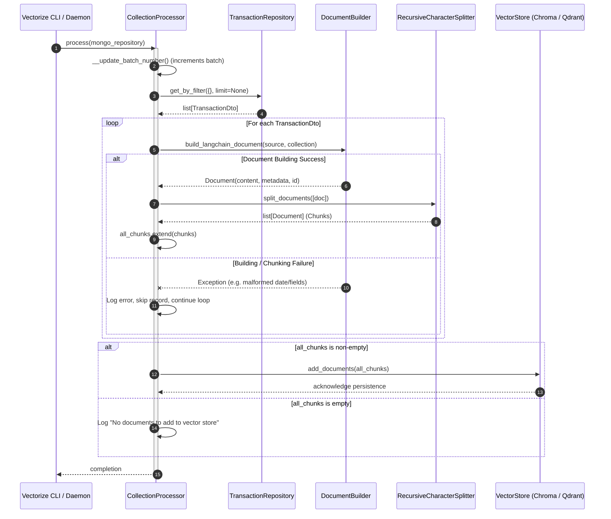

# Vectorization & Feature Processing Pipeline Specification

**Target Packages**: `features/processor.py`, `features/vectorstore/`, `features/rag/`  
**Architectural Role**: Feature Transformation, Document Chunking & Multi-Backend Vector Persistence  
**Document Status**: Canonical / Active Specification  
**Primary Classes**: [`VectorStore`](../../features/vectorstore/vectorstore.py), [`ChromaVectorStore`](../../features/vectorstore/vectorstore.py), [`QdrantVectorStore`](../../features/vectorstore/vectorstore.py), [`DataLakeProcessor`](../../features/processor.py), [`CollectionProcessor`](../../features/processor.py)  
**Parent Document**: [`docs/specs/README.md`](./README.md)  

---

## 1. Executive Summary & Core Invariants

The vectorization and processing pipeline extracts financial transaction entities from datalake repositories, constructs structured LangChain documents with standardized metadata, recursively chunks documents into semantic segments, and synchronizes vector embeddings to persistence backends.

**Headline Invariants**:
1. **Fault-Tolerant Batch Isolation**: A document construction or chunking failure on an individual transaction record must be caught, logged, and isolated; single-document exceptions must never terminate processing of subsequent records within an active batch.
2. **Provider Agnosticism**: Downstream pipelines interact exclusively with the `VectorStore` abstract port; underlying storage backends (ChromaDB SQLite or Qdrant cluster) are decoupled through `vector_store_factory`.
3. **Deterministic Splitting & Sizing**: Document chunking adheres strictly to standard token boundaries: `chunk_size = 1000`, `chunk_overlap = 100`, and `add_start_index = True`.
4. **Dry-Run Non-Destructiveness**: The manual vectorization interface must support a `--dry-run` flag that performs end-to-end extraction, document formatting, and chunking without issuing mutating API calls to vector databases.

---

## 2. Processing Pipeline Lifecycle & Sequence

The feature processing pipeline is mediated through `CollectionProcessor`, translating MongoDB datalake entities into vector embeddings:



---

## 3. Vector Store Abstraction: `VectorStore` Port & Factory

Authoritative reference: [`features/vectorstore/vectorstore.py`](../../features/vectorstore/vectorstore.py).

### 3.1 Abstract Port Contract: `VectorStore`
The pipeline relies on an abstract port `VectorStore(ABC)` defining operations for embedding, persistence, and similarity search:

```python
class VectorStore(ABC):
    def __init__(self, model: str):
        self._model = embeddings(model)

    @property
    def model(self) -> HuggingFaceEmbeddings:
        """Return this VectorStore's embedding model instance."""
        return self._model

    @abstractmethod
    def similarity_search(
        self, query_text: str, top_k: int = 5
    ) -> list[tuple[Document, float]]:
        """Perform similarity search using top-k cosine similarity."""

    @abstractmethod
    def bulk_find(
        self, collection_name: str, limit: int, offset: int | str | None, **kwargs
    ) -> Any:
        """Bulk-search the collection starting at a specific offset."""

    @abstractmethod
    def search_collection(
        self, collection_name: str, query_vector: list, limit: int, **kwargs
    ) -> list:
        """Search a Vectorstore collection directly with an embedding vector."""

    @abstractmethod
    def add_documents(self, documents: list[Document]) -> None:
        """Add documents to the vector store."""

    @abstractmethod
    def get_all(self, limit: int) -> dict[str, list]:
        """Return all embeddings, documents, and metadata from the store."""
```

### 3.2 Backend Factory: `vector_store_factory`
Vector storage adapters are resolved dynamically through `vector_store_factory(config)`:

```python
def vector_store_factory(config: dict[str, Any]) -> VectorStore:
    vector_db_type = config.get("VECTOR_DB_TYPE", "chroma").lower()
    model = config["EMBEDDING_MODEL"]

    match vector_db_type:
        case "chroma":
            return ChromaVectorStore(
                model=model,
                sqlite_dir=config["CHROMA_SQLITE_DIR"],
                collection=config["EMBEDDINGS_COLLECTION_CHROMA"],
            )
        case "qdrant":
            return QdrantVectorStore(
                model=model,
                host=config["QDRANT_HOST"],
                port=config["QDRANT_PORT"],
                collection=config["QDRANT_COLLECTION"],
            )
        case _:
            raise ValueError(f"Unknown Vector DB type: {vector_db_type}")
```

### 3.3 Target Vector Store Adapters

| Adapter Class | Underlying Engine | Storage Topology | Key Configuration Keys |
| :--- | :--- | :--- | :--- |
| `ChromaVectorStore` | `langchain-chroma` | Embedded local SQLite persistence directory | `CHROMA_SQLITE_DIR`, `EMBEDDINGS_COLLECTION_CHROMA` |
| `QdrantVectorStore` | `langchain-qdrant` / `qdrant-client` | Network service (HTTP / gRPC) | `QDRANT_HOST`, `QDRANT_PORT`, `QDRANT_COLLECTION` |

> [!NOTE]
> Embedding generation utilizes the `BAAI/bge-small-en-v1.5` transformer model (384 dimensions) via `langchain-huggingface`. `QdrantVectorStore` automatically ensures collection creation with `qmodels.Distance.COSINE` and vector size 384 upon initialization if the collection does not exist.

---

## 4. Document Building & Chunking Specification

Authoritative references: [`features/rag/documents/document_builder.py`](../../features/rag/documents/document_builder.py) and [`features/processor.py`](../../features/processor.py).

### 4.1 Document Content Formulation
`build_document_content(source, collection)` serializes a `TransactionDto` into a standard natural language sentence optimized for embedding semantic retrieval:
```python
content = (
    f"On {source.posting_date}, a transaction occurred with details: "
    f"Description: {source.description}. "
    f"Amount: ${source.amount:.2f}. "
    f"Type: {source.transaction_type}."
)
```

### 4.2 Document Metadata Normalization
`build_document_metadata(source, collection, source_id)` enforces strict typing on all LangChain metadata keys:
1. **Explicit Core Fields**: Always extracts `source_collection`, `source_document_id`, `transaction_date`, `amount`, and `type`.
2. **Complex Type Filtering**: Nested dictionaries and arrays are excluded or logged with warnings to prevent vector database indexing exceptions.
3. **Primitive Cast Invariant**: Non-serializable objects (such as BSON `ObjectId`) are explicitly cast to string via `str(v)`.
4. **Pruning**: Keys with `None` values are stripped from the final dictionary.

### 4.3 Recursive Text Chunking Configuration & Pure Helper: `chunk_transactions`
Document splitting is encapsulated in a pure, reusable module function `chunk_transactions`:

```python
def chunk_transactions(
    transactions: Iterable[TransactionDto],
    collection_name: str,
    chunk_size: int = 1000,
    chunk_overlap: int = 100,
) -> list[Document]:
    """Build and split one LangChain document per transaction.

    Records that fail to build or split are logged at warning level and skipped (P2-D3).

    :param transactions: An iterable of TransactionDto records.
    :param collection_name: Collection name stored in document metadata.
    :param chunk_size: Maximum characters per chunk (default 1000).
    :param chunk_overlap: Character overlap between chunks (default 100).
    :return: List of chunked LangChain Document objects.
    :raises TypeError: If transactions is None, or chunk_size/chunk_overlap is not an int (or is bool).
    :raises ValueError: If collection_name is empty/whitespace, chunk_size <= 0,
        chunk_overlap < 0, or chunk_overlap >= chunk_size.
    """
```

#### Parameter Validation & Defensive Guards
`chunk_transactions` enforces strict pre-flight parameter barriers:
| Parameter | Type | Validation Rules | Failure Behavior |
| :--- | :--- | :--- | :--- |
| `transactions` | `Iterable[TransactionDto]` | Must not be `None`. Accepts any finite stream or generator. | Raises `TypeError("transactions cannot be None")` |
| `collection_name` | `str` | Must be a non-empty, non-whitespace string. | Raises `ValueError("collection_name must be a non-empty string")` |
| `chunk_size` | `int` | Must be an integer (`not isinstance(chunk_size, bool)`) and `> 0`. | Raises `TypeError` if bool/non-int; raises `ValueError` if `<= 0` |
| `chunk_overlap` | `int` | Must be an integer (`not isinstance(chunk_overlap, bool)`), `>= 0`, and strictly `< chunk_size`. | Raises `TypeError` if bool/non-int; raises `ValueError` if `< 0` or `>= chunk_size` |

#### Splitter Configuration & Metadata Retention
Documents are partitioned using `RecursiveCharacterTextSplitter` configured with standard parameters:
```python
text_splitter = RecursiveCharacterTextSplitter(
    chunk_size=chunk_size,
    chunk_overlap=chunk_overlap,
    add_start_index=True,
)
```
- `chunk_size = 1000` (default): Ensures semantic units fit comfortably within the 512-token context window of `bge-small-en-v1.5`.
- `chunk_overlap = 100` (default): Preserves continuity across segment boundaries.
- `add_start_index = True`: Captures character offset positions within source document text for lineage auditing.

#### Dual-Level Exception Architecture & Observability
- **Expected Domain Errors**: Caught via `(ValueError, TypeError, KeyError, RAGError)`. Emits a `WARNING` log containing the record ID and skips the record; emits diagnostic traceback at `DEBUG` level (`exc_info=True`).
- **Unexpected Failures**: Caught via `Exception`. Emits an `ERROR` log with full stack trace (`exc_info=True`) to prevent silent ingestion bugs.
- **Safe Identifier Fallback**: Resolves `record_id = getattr(transaction, "id", None) or "unknown"` to avoid `AttributeError` or logging `None`.

---

## 5. Processing Engine: `CollectionProcessor`

`CollectionProcessor` inherits from abstract `DataLakeProcessor`:

```python
class CollectionProcessor(DataLakeProcessor):
    def process(self, mongo_repository: BaseRepository) -> None:
        self.__update_batch_number()
        collection_name = mongo_repository.collection.name
        transactions = mongo_repository.get_by_filter({})

        all_chunks = chunk_transactions(transactions, collection_name)

        if all_chunks:
            _LOGGER.info("Adding %d chunks to vector store", len(all_chunks))
            self._vector_store.add_documents(all_chunks)
        else:
            _LOGGER.info("No documents to add to vector store")
```

### 5.1 Batch Lifecycle & Exception Isolation Invariants
- **Batch State Tracking**: Each invocation of `process` increments `_batch_number` by 1.
- **Record-Level Isolation**: Individual record building and splitting failures are isolated within `chunk_transactions`. When an invalid record triggers an error, the exception is logged with record identifier context, and iteration proceeds to the next record.
- **Bulk Emission**: Vector database write operations (`add_documents`) are performed in bulk at the end of the collection scan, minimizing round-trip network overhead.

---

## 6. On-Demand Manual Vectorization CLI Specification

For operations, debugging, and backfilling, the features pipeline provides a command-line interface executable via Poetry.

### 6.1 Invocation Syntax
```bash
poetry run vectorize [OPTIONS]
```
*(Or directly via module execution: `python -m features.tools.run [OPTIONS]`)*

### 6.2 Command Options & Parameters

| Flag | Type | Default | Description |
| :--- | :--- | :--- | :--- |
| `--collection <name>` | `str` | `""` (all) | Target a single MongoDB collection name. When omitted, discovers and processes all collections matching `DATALAKE_COLLECTION_PREFIX`. |
| `--limit <n>` | `int` | `None` | Restrict extraction to the first `n` transactions per collection. Guarded by `_apply_limit` type checks. |
| `--vector-db <type>` | `str` | `config` value | Select vector persistence backend (`chroma` or `qdrant`). Overrides `VECTOR_DB_TYPE` environment setting. |
| `--dry-run` | `flag` | `False` | Execute discovery, extraction, document building, and chunking without calling `add_documents` on the vector database. |
| `--log-level <lvl>` | `str` | `INFO` | Console logging verbosity (`DEBUG`, `INFO`, `WARNING`, `ERROR`). |

### 6.3 Telemetry & Summary Console Reporting
Upon completion of a vectorization run, the CLI outputs a structured summary table:

```text
======================================================================
                   VECTORIZATION EXECUTION SUMMARY
======================================================================
Execution Mode:         DRY RUN / MUTATING
Vector Database:        Qdrant (localhost:6333, collection: babylon_vectors)
Embedding Model:        BAAI/bge-small-en-v1.5
Collections Scanned:    3 (transactions_chase, transactions_fidelity, ...)
Transactions Extracted: 450
Documents Chunked:      448
Failed / Dropped:       2 (logged in debug trace)
Total Chunks Emitted:   512
Time Elapsed:           4.82s
Throughput:             106.2 chunks/sec
======================================================================
```

---

## 7. Verification Standards & Quality Gates

Authoritative test reference: [`tests/test_processor.py`](../../tests/test_processor.py).

### 7.1 Test Strategy & Mocks
Unit tests enforce 100% hermetic isolation from live databases and GPU hardware:
1. **Repository Mocks**: `BaseRepository` / `TransactionRepository` are mocked to return canned lists of `TransactionDto` instances.
2. **Splitter & Builder Mocks**: Unit tests patch `build_langchain_document` and `RecursiveCharacterTextSplitter` to verify chunk routing and batch accumulation.
3. **Fault-Domain Assertion**: Tests verify that when `build_langchain_document` raises an exception for record 1, record 2 is still successfully processed and delivered to `VectorStore.add_documents`.

### 7.2 Quality Gates
- **Zero Live Connection Requirement**: Tests in `tests/test_processor.py` execute without live MongoDB, ChromaDB, or Qdrant connections.
- **Branch Coverage**: `features/processor.py` maintains >= 90% statement and branch coverage in CI workflows.

### 7.3 Quality Assurance Matrix

| Test Method | Scenarios Covered | Invariant Verification |
| :--- | :--- | :--- |
| `test_collection_processor_batch_number` | Batch counter incrementation. | Verifies `batch_number` increments by 1 per `process` invocation. |
| `test_collection_processor_process_success` | Full pipeline execution with mocks. | Verifies document building, chunk splitting, and vector store addition. |
| `test_collection_processor_process_skip_error` | Fault isolation on corrupt records. | Verifies exceptions on individual records are logged and skipped while valid records proceed. |
| `test_collection_processor_no_docs` | Empty datalake collection. | Verifies empty transaction lists do not invoke `add_documents`. |
| `test_process_default_chunking_unchanged` | Regression parity with default chunking. | Verifies default `chunk_size=1000` and `chunk_overlap=100` are applied by `CollectionProcessor`. |
| `test_chunk_transactions_rejects_invalid_parameters` | Parametrized parameter boundary & type validation. | Verifies booleans, non-integers, negative sizes, and overlap >= size raise appropriate `TypeError` / `ValueError`. |
| `test_chunk_transactions_rejects_none_transactions` | None transactions validation. | Verifies passing `transactions=None` raises `TypeError`. |
| `test_chunk_transactions_rejects_invalid_collection_name` | Collection name boundary validation. | Verifies empty, whitespace, or non-string `collection_name` raises `ValueError`. |
| `test_chunk_transactions_honors_size_and_overlap` | Custom chunk size and overlap boundaries. | Verifies custom parameters (500/50) constrain chunk text lengths. |
| `test_chunk_transactions_adds_start_index` | Chunk metadata enrichment. | Verifies integer `start_index` is present in each chunk's metadata. |
| `test_chunk_transactions_skips_failing_record` | Pure helper exception boundary. | Verifies corrupt record skipping in `chunk_transactions` standalone. |
| `test_chunk_transactions_logs_skip_warning` | Dual-level warning log emission. | Verifies domain errors emit `WARNING` logs containing record ID and error message via `caplog`. |
| `test_chunk_transactions_fallback_record_id_unknown` | Safe identifier fallback. | Verifies missing `id` attribute logs fallback identifier `"unknown"`. |
| `test_chunk_transactions_logs_unexpected_error` | Dual-level unexpected error logging. | Verifies unexpected exceptions log at `ERROR` level with stack trace context. |
| `test_chunk_transactions_streaming_generator` | Streaming generator / iterable consumption. | Verifies generator expressions stream and chunk without re-consumption errors. |
| `test_chunk_transactions_metadata_completeness` | Comprehensive metadata preservation. | Verifies full metadata schema (`id`, `source_collection`, `amount`, `posting_date`, `start_index`). |
| `test_chunk_transactions_text_overlap_continuity` | Semantic overlap continuity. | Verifies consecutive split chunks share tokens across split boundaries. |
| `test_chunk_transactions_sparse_dto` | Sparse DTO processing. | Verifies records with minimal/sparse fields chunk successfully without error. |
| `test_chunk_transactions_empty_input` | Boundary condition on empty iterable. | Verifies empty iterable returns `[]`. |
