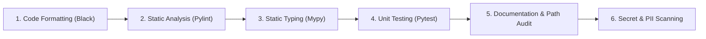

# Automated Verification Harness & Local Quality Gates

This specification defines the multi-gate automated verification harness, static analysis rules, documentation audit gates, and path privacy standards enforcing architectural and quality compliance across `babylon_features`.

---

## 1. Quality Gates Overview

Every modification in `babylon_features` must pass 6 consecutive automated quality gates before pull request creation or merging:



The entire verification harness is packaged into a single command:
```bash
make verify
# or directly
./scripts/verify.sh
```

---

## 2. Gate 1: Code Formatting Gate (Black)

Enforces PEP-8 code formatting standards across all Python source modules:

```bash
poetry run black features --check
```

- Target: Zero diff violations.
- Auto-remediation: Run `make fmt` or `poetry run black features tests/datalake`.

---

## 3. Gate 2: Static Analysis & Linter Gate (Pylint)

Executes static analysis across core packages (`features/datalake`, `features/processor.py`, `features/vectorstore`, `features/tools`):

```bash
poetry run pylint features/datalake features/processor.py features/vectorstore
```

- Strict Target: Minimum **9.50/10** rating (current baseline: **10.00/10**).
- Zero wildcard exception handlers or uncaught generic exceptions without logging.
- Cognitive complexity kept flat with early returns and guard clauses.

---

## 4. Gate 3: Static Type Checking Gate (Mypy)

Enforces strict static typing across repository and tooling layers:

```bash
poetry run mypy features/datalake
```

- Zero type errors or missing parameter/return annotations on public methods.
- Driver integration interfaces explicitly annotated (`Collection`, `Any`, `TransactionDto | None`).

---

## 5. Gate 4: Unit Test Suite & Assertion Rigor Gate (Pytest)

Executes unit test suites with declarative fixtures and test doubles:

```bash
poetry run pytest tests/datalake/test_repository.py -v
```

- **Domain Builders**: Tests eliminate repetitive boilerplate using `new_valid_dto(**overrides)`.
- **Assertion Depth**: Asserts not only mock call invocations (`find`, `limit`) but also verifies returned mapped domain DTOs and corrupted record filtering.
- **Negative & Boundary Testing**: Verifies boundaries (`limit=1`), non-positive numbers (`0`, `-1` raising `ValueError`), and invalid types (`True`, `1.5`, `"10"` raising `TypeError`).

---

## 6. Gate 5: Documentation & Path Privacy Audit Gate

Ensures documentation remains synchronized with code changes and maintains strict path privacy:

### 5.1 Path Privacy Audit
Scans all committed and modified files for forbidden personal, home, or local absolute directory paths:
```bash
git grep -E "(/Users/[a-zA-Z0-9]|/home/[a-zA-Z0-9]|~/[a-zA-Z0-9])" -- '*.py' '*.md' '*.yaml' '*.toml'
```
- Invariant: Zero absolute home directory paths permitted. All paths must be repository-relative.

### 5.2 Documentation Synchronization Check
Detects when production implementation code (`features/`) is modified without corresponding updates to specifications (`docs/specs/`), agent operational guidelines (`AGENTS.md`), or project documentation (`README.md`):
- Non-strict mode: Emits explicit warnings and guidance.
- Strict mode (`./scripts/verify.sh --strict` / `make verify-strict`): Fails the gate to prevent architectural specification drift.

### 5.3 Relative Link Integrity
Validates that all relative markdown links in `docs/specs/*.md` resolve to valid files.

---

## 7. Gate 6: Secret & Sensitive File Scan

Scans git working trees and staged diffs to prevent accidental credential exposure:
```bash
git diff --cached | grep -E '(BEGIN PRIVATE KEY|AWS_SECRET_ACCESS_KEY|ghp_|gho_)'
```
- Prohibits hardcoded API tokens, private keys, or passwords.
- Verifies `.env` files are excluded from commits.

---

## 8. Makefile Target Reference

| Target | Description |
| :--- | :--- |
| `make verify` | Runs all 6 gates sequentially. |
| `make check-quality` | Runs formatting, linting, and type checking. |
| `make test` | Runs unit test suites. |
| `make fmt` | Re-formats codebase with black. |
| `make verify-docs` | Runs documentation audit, path privacy scan, and link verification only. |
| `make verify-strict` | Runs all gates and strictly rejects code changes missing documentation updates. |
